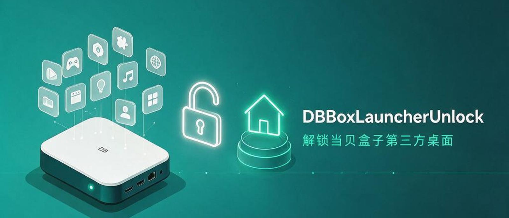

<div align="center">



# DBBoxLauncherUnlock

**让当贝盒子可以随意安装并设为默认的第三方桌面。**

</div>

当贝盒子出厂时把 HOME（桌面）应用做了白名单：只有自家/合作方的桌面能出现在"选择主屏幕应用"里。装了别的桌面（如 [Aerial](https://github.com/pengchujin/aerial-tv/releases)、[Projectivy](https://play.google.com/store/apps/details?id=com.spocky.projengmenu)、原生 Android TV Launcher 等）在系统里根本看不到。

这个 LSPosed 模块解除这个限制，让任意桌面应用都能正常成为默认 HOME。

## 你需要准备什么

- 一台 **当贝盒子**（Dangbei OS 4.0，Android 11 验证可用；其他型号待验证）
- 已获取 Root 权限，并已安装并激活 **LSPosed**（`LSPosed-v2.2.1-7939-release` 或更高版本均可）
- 一台电脑 + `adb` 连接盒子（`adb connect <盒子IP>:5555`）

> 如果还没上 LSPosed，本项目帮不了你，先去找方法搞定 Magisk/APatch/KernelSU + LSPosed。

## 安装步骤

1. **安装模块 APK**

   ```bash
   adb install dbboxlauncher-unlock.apk
   ```

   > 不会编译的话直接从 [Releases](https://github.com/Higanoneko/DBBoxLauncherUnlock/releases) 下载现成的 APK。想自己构建见 [Dev.md](Dev.md)。

2. **启用模块**

   - 打开 LSPosed 管理器 → 模块 → 找到 **DBBoxLauncherUnlock**
   - 打开开关，作用域勾选 **Android 系统**

3. **重启盒子**（必须重启，system_server 需要重新加载）

4. **装你想要的桌面**

   ```bash
   adb install <第三方桌面.apk>
   ```

   然后在 Android设置 →  设备偏好设置 →  高级设置 →  主屏幕应用里选它即可。

## 验证是否生效

- 重启后如果 LSPosed 日志（`logcat -s DBBoxLauncherUnlock`）出现 `hooked isNotDangbeiLauncher OK`，说明 hook 成功。
- 装第三方桌面后按 HOME 键，弹出"选择主屏幕应用"对话框即表示解锁成功。

## 常见问题

**Q: 启用后看不到效果？**
检查 LSPosed 里模块是否已勾选 + 作用域是否是"Android 系统"+ 是否重启过盒子。

**Q: 我的盒子不是 当贝H3 OS 4.0.0.2 可以用吗？**
不确定。这个 hook 是针对当贝 OS 某个私有方法的，不同固件不一定存在该方法。模块找不到方法时会打印失败日志，但不会影响系统。可自行尝试。
当然，你也可以拿到相关资料后交给我，我来处理。

**Q: 会影响系统更新 / 其他应用吗？**
不会。模块作用域只勾 `system`，不 hook 其他应用；副作用仅限放开桌面白名单。

## 相关链接

- 构建、原理、调试细节：[Dev.md](Dev.md)
- 第三方组件声明：[THIRD-PARTY-NOTICES.md](THIRD-PARTY-NOTICES.md)

## License

Apache License 2.0 — 见 [LICENSE](LICENSE)。
